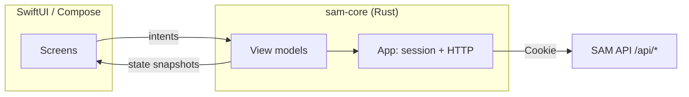

# SAM native app

Native SAM client for iOS, macOS and Android. It's an early version. You can sign in to any SAM
server (hosted or self-hosted), browse your projects and their chat sessions, start a task, follow
the agent's conversation and task status, open the resulting pull request, and reply to the agent.

## Layout

| Path       | What                                                                                                                                                                |
| ---------- | ------------------------------------------------------------------------------------------------------------------------------------------------------------------- |
| `core/`    | Rust crate `sam-core`: sign-in, session, API client and one view model per screen. Exported to Swift and Kotlin with [UniFFI](https://mozilla.github.io/uniffi-rs/) |
| `ios/`     | SwiftUI shell (`SAM.xcodeproj`, scheme `SAM`). One target builds for iPhone, iPad and the Mac (Apple silicon)                                                       |
| `android/` | Jetpack Compose shell (single `app` module)                                                                                                                         |
| `scripts/` | Builds the core for each platform and generates its bindings                                                                                                        |

The shells stay thin. Each screen owns a Rust view model: the shell reads the first snapshot with
`state()`, sends intents (`load`, `submit_task`, `send`, …), and receives every later snapshot
through an observer callback. Logic and HTTP live in the core, so both platforms behave the same.



## Sign-in

The app uses SAM's device flow, the same one `sam login` uses (`apps/api/src/routes/device-flow.ts`):

1. The user enters the server (`api.simple-agent-manager.org` by default). Pasting the web app's
   address (`app.<domain>`) also works because `server::normalize` maps it to `api.<domain>`.
2. `App::begin_sign_in` creates a device code (`POST /api/auth/device/code`). The shell shows the
   code and opens the approval page (`app.<domain>/device?code=…`) in the browser, where the user
   is already signed in to SAM.
3. `App::finish_sign_in` polls `POST /api/auth/device/token` until the code is approved, then
   stores the returned session cookie through the shell's `CredentialStore` (Keychain on Apple
   platforms, a Keystore-encrypted preference on Android).

Every API call sends that cookie. A `401` signs the app out and clears the store
(`App::send` in `core/src/session.rs`). The flow needs no server-side changes and no
app-specific OAuth client.

## Core

```sh
cd apps/mobile/core
cargo test     # parsing, URL normalization, and device-flow sign-in against a scripted server
cargo clippy --all-targets -- -D warnings
```

## iOS and macOS

`ios/Generated/` (the XCFramework and Swift bindings) is build output and gitignored. Build it
before opening Xcode:

```sh
rustup target add aarch64-apple-ios aarch64-apple-ios-sim aarch64-apple-darwin   # once
apps/mobile/scripts/build-ios.sh                                                 # after every core change
open apps/mobile/ios/SAM.xcodeproj
```

Pick your team under Signing & Capabilities (the project has no `DEVELOPMENT_TEAM`). Bundle id:
`org.simpleagentmanager.app`, iOS 17+ and macOS 14+. Swift sources live in `ios/SAM/`, a
synchronized folder, so Xcode picks up new files without project edits. Build without signing:

```sh
xcodebuild -project apps/mobile/ios/SAM.xcodeproj -scheme SAM \
  -destination 'generic/platform=iOS Simulator' CODE_SIGNING_ALLOWED=NO build
xcodebuild -project apps/mobile/ios/SAM.xcodeproj -scheme SAM \
  -destination 'platform=macOS,arch=arm64' CODE_SIGNING_ALLOWED=NO build
```

For Xcode Cloud, `ios/ci_scripts/ci_post_clone.sh` installs Rust and runs `build-ios.sh`
before Xcode builds.

## Android

Gradle's `buildRustCore` task (`preBuild` depends on it) runs `scripts/build-android.sh`. That
script uses `cargo ndk` to build `libsam_core.so` for arm64-v8a and x86_64, and `uniffi-bindgen`
to write the Kotlin bindings (package `org.simpleagentmanager.core`) into `android/app/build/rust/`.
No separate step is needed:

```sh
rustup target add aarch64-linux-android x86_64-linux-android   # once
cargo install cargo-ndk                                        # once
cd apps/mobile/android && ./gradlew assembleDebug              # or open the folder in Android Studio
```

You need JDK 17+, the Android SDK (`ANDROID_HOME` or `local.properties` `sdk.dir`) and an NDK
(`ANDROID_NDK_HOME`, or the newest one under `$ANDROID_HOME/ndk`). Application id:
`org.simpleagentmanager.app`, minSdk 26.

## CI

`ci/native-app.yml` checks the core (fmt, clippy, tests), builds the Android debug APK (kept as
an artifact for 7 days), and builds the Apple app for the iOS Simulator and macOS, on changes under
`apps/mobile/`. Nothing is signed or published yet. It isn't active yet: an automation token
can't add workflows, so someone with that permission needs to move it into place:

```sh
git mv apps/mobile/ci/native-app.yml .github/workflows/native-app.yml
```

## Not yet

- Live updates: the chat polls every 4 s while on screen. It doesn't use the web app's WebSocket.
- Push notifications for sessions that need attention.
- Task options (agent, profile, VM size) and attachments: tasks use the project's defaults.
- Older messages: the chat shows the latest page only.
- Release signing and store uploads.
