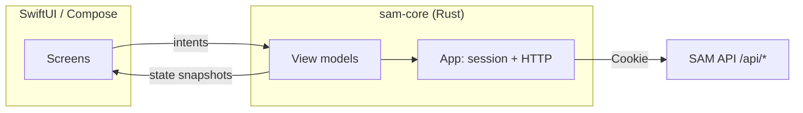

# SAM native app

Native SAM client for iOS, macOS and Android. It's an early version. You can sign in to any SAM
server (hosted or self-hosted), browse your projects and their chat sessions, start a task, follow
the agent's conversation and task status, open the resulting pull request, and reply to the agent. Tasks and replies can carry files.
A new task runs with the agent profile you pick, and you can create, edit and delete the project's profiles.

## Layout

| Path       | What                                                                                                                                                                |
| ---------- | ------------------------------------------------------------------------------------------------------------------------------------------------------------------- |
| `core/`    | Rust crate `sam-core`: sign-in, session, API client and one view model per screen. Exported to Swift and Kotlin with [UniFFI](https://mozilla.github.io/uniffi-rs/) |
| `ios/`     | SwiftUI shell (`SAM.xcodeproj`, scheme `SAM`). One target builds for iPhone, iPad and the Mac (Apple silicon)                                                       |
| `android/` | Jetpack Compose shell (single `app` module)                                                                                                                         |
| `scripts/` | Builds the core for each platform and generates its bindings                                                                                                        |

The shells stay thin. Each screen owns a Rust view model: the shell reads the first snapshot with
`state()`, sends intents (`load`, `submit_task`, `send`, …), and receives every later snapshot
through an observer callback. Logic and HTTP live in the core, so both platforms behave the same.

New-chat submission stays locked in the shared core from intent admission through
request completion, session refresh, and the UI handoff. After `submit_task`
returns a session, each shell clears its draft and opens that session before
calling `finish_submission(session_id)`. Only the matching accepted session can
release the lock; failed requests unlock for retry. Apple also sets a local busy
flag synchronously on tap, before observer delivery.



## Sign-in

The app uses SAM's device flow, the same one `sam login` uses (`apps/api/src/routes/device-flow.ts`):

1. The user taps Sign in. The app signs in to the deployment its build presets (`BASE_DOMAIN`, see
   [White-label builds](#white-label-builds)); self-hosters tap "Use another server" and type
   their domain. `server::normalize` maps a base domain, the web app (`app.<domain>`) or the API
   to `https://api.<domain>`, the platform's URL rule. The API address never appears in the UI.
2. `App::begin_sign_in` creates a device code (`POST /api/auth/device/code`). The shell shows the
   code and opens the approval page (`app.<domain>/device?code=…`) in the browser, where the user
   is already signed in to SAM.
3. `App::finish_sign_in` polls `POST /api/auth/device/token` until the code is approved, then
   stores the returned session cookie through the shell's `CredentialStore` (Keychain on Apple
   platforms, a Keystore-encrypted preference on Android).

Every API call sends that cookie. A `401` signs the app out and clears the store
(`App::send` in `core/src/session.rs`). The flow needs no server-side changes and no
app-specific OAuth client.

## Provisioning status

Open **Session tools (⋯) → Progress** for task status, output/PR links, informational notifications,
and setup details. Progress cards do not appear before or after the conversation. Questions,
secret requests and approvals remain in chat, including requests recovered from older notifications.

While a new chat's VM/container is being prepared, Progress shows elapsed time and the web chat's
four stages: provisioning the VM, cloning the repository, installing dependencies, and starting
the agent. The existing chat poll refreshes it; opening Progress also refreshes its snapshot.
Setup progress disappears when the agent starts; setup failures use the task card's error.
The core reads the full task only for queued/delegated active sessions, checking `startedAt`
and `admissionState` so waking sessions and provider-limit holds do not show first-boot progress.

## Global SAM assistant

The main SAM tab appears when `/api/sam/settings` reports both `enabled` and `available`
(`App::refresh_assistant_settings`, refreshed while the signed-in shell is active). It uses the
same private account conversation as web, separate from project-agent chat.

`AssistantViewModel` in `core/src/assistant.rs` reads current and earlier history, polls active-turn
progress, submits messages, stops SAM, confirms or declines actions, reconciles uncertain task starts,
and marks project-work updates seen. `ios/SAM/AssistantView.swift` and Android `Assistant.kt` render
these states and open project chats natively. Other destinations, including Settings, open on web.
The shells persist uncertain submissions in Keychain or encrypted private preferences before POST;
retries retain the original request key and message across app restarts. The core binds requests to
the login that created the view model and clears visible state when that login ends.

Voice entry records at most two minutes and sends audio to the existing `/api/transcribe` endpoint
(`AssistantViewModel::transcribe`). Transcription fills the draft for review; it never sends a turn.
Recordings are removed after transcription or cancellation, and when the screen leaves the foreground.
See [assistant verification](verification/assistant/README.md) for native layout renders and wire tests.

## Notifications and agent requests

The Notifications tab loads the signed-in user's inbox, including read notifications, and follows
all cursor pages. It refreshes while visible and links items to the conversation or web action.
Dismissing a notification removes it from the inbox; it does not answer or decline the request.

Both the inbox and chat render agent questions (option buttons or a text answer), secret requests
(masked value, save or decline), and Operations approvals (approve or deny). Cards load current
question text, permissions and status from the same endpoints as web before enabling actions.
They refresh every 15 seconds. Resolved or expired request cards disappear from chat,
including cards recovered from notifications; delivery-pending requests stay visible.
The Notifications screen retains resolved outcomes for history. Operations
decisions require server-authorized admin access and the approval's own project; destructive
actions show a warning.

Chat reads card references from tool metadata, including compact `rawOutput`, and tool content.
It also reads session-scoped notifications so requests remain visible when their tool calls are
outside the current message page. A request shown in the transcript is not repeated from the inbox.

Secret values remain in the form's transient state, go directly to the dedicated secret endpoint,
and are cleared after success or leaving the form. They never become chat prompts or core state.
Replacing a project value requires consent tied to the exact existing version; a changed version
requires fresh consent. A failed save preserves the input for retry. Permissions match web.
## Chat tools

The top-right **Session tools** menu follows the web tool rail's groups: workspace and
history, session actions, then task completion and details. Files and Git are offered only
for an active workspace to its owner or a teammate with shared access. Completing or
cancelling a task asks for confirmation and uses the web's task-status transition rules.

- **Files** browses directories and opens selectable, line-numbered source. **Git** separates
  staged, unstaged and untracked files; staged diffs retain the staged flag, renamed files
  show their old path, and untracked files open as source. `ChatToolsViewModel` uses the
  same `/sessions/:id/files/*` and `/git/*` proxies as web. `code_lines` parses unified-diff
  hunk offsets in Rust so the two shells share line numbering and addition/removal markers.
- **Resources** charts session CPU, memory and read/write I/O from
  `/sessions/:id/resource-timeline` minute rollups. Missing samples remain gaps; charts do
  not invent zeroes or connect separate VM runs. Older chunks without rollups are not
  plotted. Collection failures, pending history and omitted chunks are disclosed.
- **Details** includes session/task status, workspace and VM status/hardware, and provider
  usage from `/projects/:id/credential-limits?agentSessionId=...`. Remaining amounts appear
  only when reported by the provider. These are usage windows, not an assumed credit
  balance; their observation and reset times are shown. Owner-only infrastructure endpoints
  are not called for teammates.
- Related, Automation, Comments, Share, Retry, Fork and Report are marked **(web)**. They
  hand off to the corresponding web panel or prefilled composer with `?tool=...`.
  `useRequestedSessionTool` waits for web's authoritative available-action list, consumes
  the query once, and never accepts Complete/Cancel from a URL. The matching web change
  must deploy alongside the native app for these direct handoffs.

Apple tool surfaces use Liquid Glass with the existing material fallback. Android uses
neutral translucent surfaces, a light rim and a subtle gradient. File/diff parsing and API
logic stay in Rust; the shells use Swift Charts and Compose drawing for the plots, without
adding a platform-specific viewer dependency.

## Attachments

The composer takes files from its attach button (Files and Photos on Apple platforms, files and
the photo picker on Android). On iOS and macOS, files and images can also be pasted into
the input (`ios/SAM/ComposerTextInput.swift:AttachmentTextView.paste` and
`ios/SAM/ProjectView.swift:Composer.composerInput`). Ordinary text paste stays in the draft.
The composer also accepts drag and drop onto the input bar (Finder, the Files app,
iPad and Android split screen). Each file uploads as soon as it is added, the way the web app does
it (`apps/web/src/pages/project-chat/useAttachments.ts`), so the core needs no new server routes:

1. `POST /api/projects/:id/tasks/request-upload` returns a presigned R2 URL.
2. The core `PUT`s the bytes there (no cookie: the URL is the grant).
3. `tasks/submit` or `sessions/:id/prompt` carries `attachments: [{uploadId, filename, size,
contentType}]`; the server checks them against R2 and copies them into the agent's workspace.

The shell hands the core each file as a name, a type, a size and an `AttachmentSource` callback;
the core checks the limits (`ATTACHMENT_DEFAULTS`), makes the name safe (`sanitizeFilename`),
reads the file on a worker thread, and shows progress and errors in `state.attachments`. Send is
blocked while a file is uploading or failed. A message with files and no text asks the agent to
read them. Follow-ups with files need durable prompt delivery on the server, as on the web.

## Chat timeline

Both shells render the core's `ChatItem` snapshots. Streamed reply chunks join into one
Markdown message; tool updates merge by call ID, and runs of tools and thoughts fold into
expandable activity. Plans show their latest entries. System deliveries and workspace reports
appear as notices with optional details. Markdown supports headings, inline styles, links,
lists, task lists, quotes, code and tables; wide code and tables scroll horizontally.

Follow-ups appear immediately in an outbox and remain marked as sending or queued until the
server transcript contains them. Failed sends restore the draft. Reading older messages pauses
following; the down-arrow button returns to the latest messages. Older history is still limited
to the latest page from the server.

Android's `ChatContent` accepts a state snapshot and callbacks. Robolectric tests exercise
actual Compose views without signing in, including expanded activity, the history arrow,
and editor focus while a draft wraps.
The official Compose screenshot plugin renders phone, dark, tablet, large-text, arrow and expanded-composer previews:

```sh
cd apps/native/android
./gradlew assembleDebug testDebugUnitTest
./gradlew updateDebugScreenshotTest       # regenerate preview baselines
./gradlew validateDebugScreenshotTest     # compare against checked-in baselines
# app/src/screenshotTestDebug/reference/
```

## Agent profiles

A profile is a saved setup for new chats: the agent, model, effort, permission mode, work type
(task or conversation) and extra instructions, the machine (runtime, minimum vCPUs, memory and disk,
a dedicated node, the workspace and its devcontainer) and limits (max turns, timeout).
The project screen shows the selected profile in
the composer (on iOS and macOS, at the top of its glass container while the text field has focus;
on Android, above it). Its menu switches profiles and opens the editor ("Edit", "New profile"). Everything
goes through the routes the web app uses (`apps/api/src/routes/agent-profiles.ts`):

- `GET /api/projects/:id/agent-profiles` and `.../agent-profiles/picker` load the list. The
  user's recent profiles come first and the ones they hid on the web are left out. The pre-selection
  matches the web picker (`selectProfileId`): the current choice while it exists, else the most
  recent profile, else the first one.
- `tasks/submit` sends the selected profile as `agentProfileId`. With no profile, the server uses
  the project's defaults.
- `POST`, `PUT` and `DELETE .../agent-profiles[/:id]` save and delete profiles. The editor covers
  the fields above. Fields it doesn't show (provider, location, GitHub CLI policy, AI models) keep
  their values. The machine follows the web form: requirements go out as `resourceRequirementsJson`,
  keeping any keys the app doesn't know. The older fixed size (`vmSizeOverride`) shows only while a
  profile still has it, with a way to clear it. An instant container (`cf-container`) has no machine
  settings and always uses a lightweight workspace.
  Only the project's own profiles can be edited here. The user's global profiles can be picked but
  not edited, as the server refuses that in a project's scope.

The lists the editor offers (`supported_efforts`, `permission_modes`, `task_modes`) mirror
`packages/shared` and live in `core/src/agent_profiles.rs`. The agents come from `GET /api/agents`.

## Push notifications

The app gets the notifications the web app sends as Web Push (agent questions, task results,
mentions), through the platform's own push service, and a tap opens the conversation. The server
side mirrors Web Push (`apps/api/src/durable-objects/notification-native-push.ts`): the same
payload builder, the same **Settings → Notifications** push preferences and the same receipts.

1. Once signed in, the app asks for permission and registers with the OS (`ios/SAM/Push.swift`,
   `android/.../Push.kt`).
2. The OS hands over a device token; the shell passes it to `App::set_push_token`. The core sends
   it to `POST /api/notifications/push/native-tokens` while signed in (again after a later sign-in)
   and removes it with `DELETE` on sign-out.
3. The server sends to APNs (iOS, macOS) or FCM (Android). A message carries `projectId` and
   `sessionId`; tapping it opens that chat. On Android the server sends data-only messages and the
   app shows them itself, so a tap works whether the app was open or not.

Each deployment brings its own app identities, all through environment variables:

| Where      | Variables                                                                                                                                                                                                                          |
| ---------- | ---------------------------------------------------------------------------------------------------------------------------------------------------------------------------------------------------------------------------------- |
| SAM server | `APNS_KEY_ID`, `APNS_TEAM_ID`, `APNS_PRIVATE_KEY` (.p8, PEM or base64), `APNS_TOPIC` (= `SAM_BUNDLE_ID`), `FCM_SERVICE_ACCOUNT_JSON` (raw or base64). GitHub Environment secrets; `configure-secrets.sh` copies them to the Worker |
| Android    | `FIREBASE_PROJECT_ID`, `FIREBASE_APP_ID`, `FIREBASE_API_KEY`, `FIREBASE_SENDER_ID` at build time (Firebase → Project settings → your Android app). No `google-services.json`                                                       |
| iOS, macOS | Nothing extra: enable Push Notifications on the App ID; the entitlement is in `SAM.entitlements` / `SAMMac.entitlements`                                                                                                           |

A platform without its variables simply has no push. Debug builds register as APNs sandbox tokens,
everything else as production.

## Core

```sh
cd apps/native/core
cargo test     # parsing, URL normalization, and device-flow sign-in against a scripted server
cargo clippy --all-targets -- -D warnings
```

## iOS and macOS

`ios/Generated/` (the XCFramework and Swift bindings) is build output and gitignored. Build it
before opening Xcode:

```sh
rustup target add aarch64-apple-ios aarch64-apple-ios-sim aarch64-apple-darwin   # once
apps/native/scripts/build-ios.sh                                                 # after every core change
open apps/native/ios/SAM.xcodeproj
```

Set your team and bundle id as described in [White-label builds](#white-label-builds); the
project itself has neither. iOS 17+ and macOS 14+. Swift sources live in `ios/SAM/`, a
synchronized folder, so Xcode picks up new files without project edits. Build without signing:

```sh
xcodebuild -project apps/native/ios/SAM.xcodeproj -scheme SAM \
  -destination 'generic/platform=iOS Simulator' CODE_SIGNING_ALLOWED=NO build
xcodebuild -project apps/native/ios/SAM.xcodeproj -scheme SAM \
  -destination 'platform=macOS,arch=arm64' CODE_SIGNING_ALLOWED=NO build
```

The app icon is an Icon Composer file, `ios/SAM/AppIcon.icon` (the SAM logo on its green), so
it renders with Liquid Glass on iOS 26 and macOS 26. There is no asset-catalog icon. The app's own
floating controls (the composer island, buttons, the task card, your messages) use Liquid Glass
through `ios/SAM/Glass.swift`, with a material fallback before iOS 26 and macOS 26.

### Xcode Cloud

`ios/ci_scripts/ci_post_clone.sh` writes the build's identity from the workflow's environment
variables (`scripts/configure-ios.sh`), installs Rust and runs `build-ios.sh` before Xcode builds.
To set it up for your own copy:

1. Register an explicit App ID for your bundle id under your team (developer.apple.com →
   Identifiers), and create the app in App Store Connect with that bundle id.
2. Locally, write your identity once and open the project:
   `SAM_TEAM_ID=… SAM_BUNDLE_ID=… apps/native/scripts/configure-ios.sh`.
3. In Xcode: Product → Xcode Cloud → Create Workflow, product `SAM`, scheme `SAM`.
4. In the workflow's Environment, add `SAM_TEAM_ID` and `SAM_BUNDLE_ID` (and any other variable
   from the table below). Add an Archive action for iOS (and macOS if you want both).

## White-label builds

Nothing in the repository names a team or a private bundle id. `ios/Config/Brand.xcconfig` holds
the upstream defaults, and `ios/Config/Local.xcconfig` (gitignored) overrides them.
`scripts/configure-ios.sh` writes that file from the environment, and Xcode Cloud runs it. Android
reads the same variables in `android/app/build.gradle.kts`.

| Variable                | Default                      | What                                                                           |
| ----------------------- | ---------------------------- | ------------------------------------------------------------------------------ |
| `BASE_DOMAIN`           | `simple-agent-manager.org`   | The deployment the app signs in to, named as on the platform (`api.` is added) |
| `SAM_BUNDLE_ID`         | `org.simpleagentmanager.app` | Bundle id (iOS/macOS) and application id (Android)                             |
| `SAM_APP_NAME`          | `SAM`                        | Name under the icon and on the sign-in screen                                  |
| `SAM_TEAM_ID`           | (none)                       | Apple Developer team id (iOS/macOS signing)                                    |
| `SAM_MARKETING_VERSION` | `0.1`                        | Version (iOS/macOS; Android uses `VERSION_NAME`)                               |
| `SAM_BUILD_NUMBER`      | `1`, or `CI_BUILD_NUMBER`    | Build number (iOS/macOS; Android uses `VERSION_CODE`)                          |

The upstream bundle id belongs to the upstream project. Build your own copy under your own id.

## Strings and translation

Every user-facing string goes through the platform's string resources, even before there are
translations:

- **Apple**: the String Catalog `ios/SAM/Localizable.xcstrings`. SwiftUI literals (`Text("…")`,
  `Button("…")`) are extracted automatically when Xcode builds. Strings built in code use
  `String(localized:)`. Use `Text(verbatim:)` for values that must not be translated (ids, code,
  the brand name).
- **Android**: `android/app/src/main/res/values/strings.xml` through `stringResource` and
  `pluralStringResource`. No literals in composables.
- **Core**: the Rust core sends no wording. Errors reach the screens as `UserError` values, and
  each shell writes and translates their text (`UserError.message` in `ios/SAM/Format.swift`,
  `UserError.message()` in `Screens.kt`). Text the SAM server sends (`UserError::Server`, task
  summaries) is shown as is.

## Android

Gradle's `buildRustCore` task (`preBuild` depends on it) runs `scripts/build-android.sh`. That
script uses `cargo ndk` to build `libsam_core.so` for arm64-v8a and x86_64, and `uniffi-bindgen`
to write the Kotlin bindings (package `org.simpleagentmanager.core`) into `android/app/build/rust/`.
No separate step is needed:

```sh
rustup target add aarch64-linux-android x86_64-linux-android   # once
cargo install cargo-ndk                                        # once
cd apps/native/android && ./gradlew assembleDebug              # or open the folder in Android Studio
```

You need JDK 17+, the Android SDK (`ANDROID_HOME` or `local.properties` `sdk.dir`) and an NDK
(`ANDROID_NDK_HOME`, or the newest one under `$ANDROID_HOME/ndk`). Application id:
`org.simpleagentmanager.app`, minSdk 26.

## CI

Builds for TestFlight and App Store Connect run on Xcode Cloud (see [Xcode Cloud](#xcode-cloud)).
There is no GitHub Actions workflow for the native app yet; locally, the commands under
[Core](#core), [iOS and macOS](#ios-and-macos) and [Android](#android) are the checks.

## Not yet

- Live updates: the chat polls every 4 s while on screen. It doesn't use the web app's WebSocket.
- Per-task options besides the profile (VM size, node): tasks use the profile's or project's settings.
- Profile provider and location, GitHub CLI policy, AI models, and hiding profiles from the picker: edit those on the web.
- Older messages: the chat shows the latest page only.
- Translations: the strings are extracted, but only English exists so far.
- Release signing and store uploads on Android.

### Viewing files in chat

`documents::resolve` in the core recognizes the persisted `display_from_library`,
`upload_to_library`, and `replace_library_file` tool metadata, including sparse updates
correlated by `toolCallId`. The native transcript shows library images as small cards;
tapping one opens the session's image gallery with navigation and zoom. Other library
files show their name, size and caption and open in Quick Look on Apple platforms or
an installed Android file viewer. Deleted files retain an unavailable card.

`ChatViewModel::document_bytes` fetches referenced files through the signed-in core,
using the project-scoped library download route. Preview downloads are limited to
20 MiB. Cookies and remote URLs never pass to external viewers. Android shares only
the downloaded file through a temporary read grant; Apple previews use a temporary copy.

## Project management

The Projects toolbar creates projects natively. Choose a connected GitHub account and repository,
search GitLab projects, or select SAM-hosted when the deployment enables it. Repository selection
fills the default branch and suggests a project name; the name and optional description are editable.
Connect new provider accounts on the web before selecting them here.

Project settings (in the project's toolbar) edit its name, description and default branch. Repository
identity stays fixed, as on the web. Deleting a project requires typing its current name exactly and
permanently removes associated data. Server authorization errors stay in the editor, preserving the
draft. Existing agent-profile management remains in the composer. Advanced access, account,
infrastructure, runtime and deployment settings remain available in the web app.

Both shells use `ProjectManagementViewModel`: GitHub installation/repository discovery, GitLab
project search, deployment capability discovery, and `POST /api/projects`, `GET/PATCH/DELETE
/api/projects/:id`. PATCH sends only general settings, so other settings keep their values.
Concurrent loads and mutations are serialized. Apple sheets and project cards use Liquid Glass
with material fallbacks on older OS versions.
