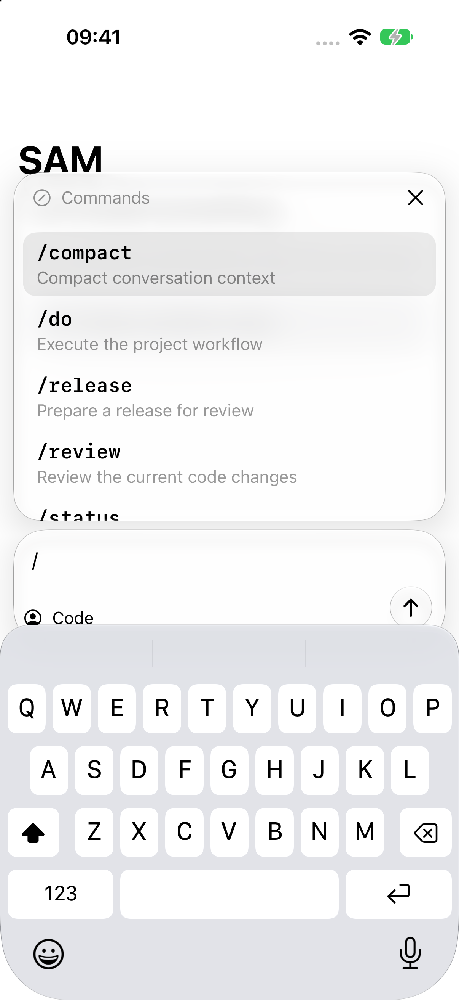
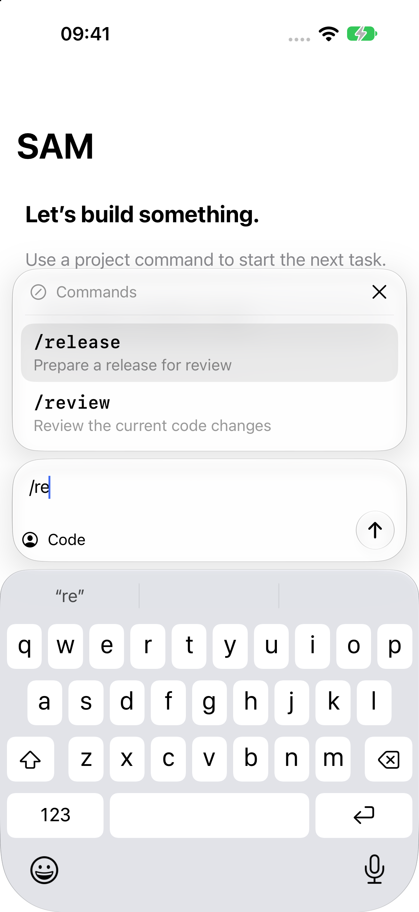
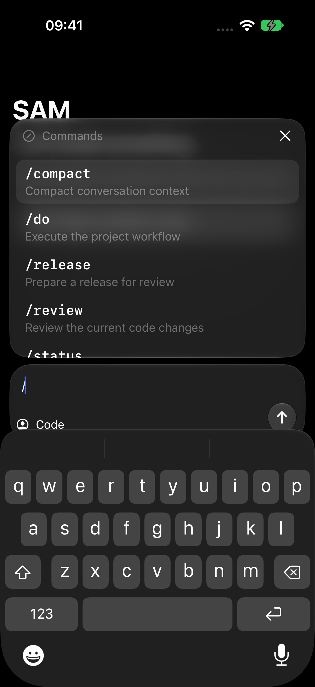
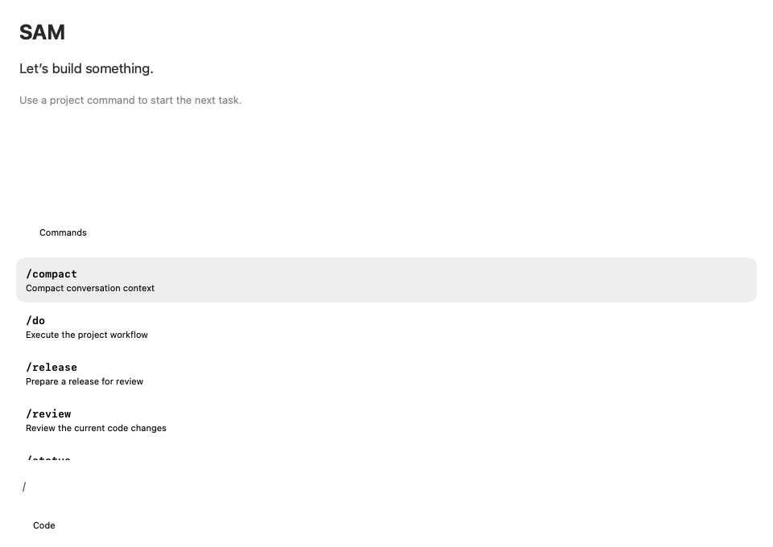

# Apple slash command verification

The offline fixtures compile the production Composer, SlashCommandPicker,
SlashCommandQuery, and platform editor together with the real generated bindings.
Only the app entry point and command data are replaced. They never sign in or
submit an agent task.

From the repository root on a Mac:

```sh
sh apps/native/scripts/build-ios.sh
bash apps/native/ios/tests/slash-commands.sh /tmp/sam-slash-evidence
```

The iOS fixture verifies discovery, filtering, arrow/Return selection, trailing
arguments, focus retention, Escape dismissal, unknown-command editing and no
auto-send. The script captures actual simulator screenshots at synchronized
checkpoints, including the software keyboard, then deletes its simulator.

For desktop verification, make an isolated copy of `apps/native/ios`, replace
`SAM/SAMApp.swift` with `ios/tests/slash-commands-macos.swift`, and build the SAM
scheme for macOS with `CODE_SIGNING_ALLOWED=NO`. Run its executable with
`SAM_SCREENSHOT_DIR` set to an existing evidence directory. It checks desktop
arrow/Return selection and records a production-composer render.

Shared-core tests use an authenticated HTTP fixture to verify cached custom
commands, registry overrides, and unavailable-cache fallback without leaking
commands between projects.

Validated with Xcode 27 on the Mac:

- PASS: all 84 shared-core tests and Clippy with `-D warnings`.
- PASS: production iOS Simulator and macOS builds.
- PASS: `ios/ci_scripts/ci_post_clone.sh` with `CI_PRODUCT_PLATFORM=macOS`, including
  existing resource/file renders, project sheet regression, rebuilt Apple core,
  generated bindings and uploaded-preview Swift/Rust/ImageIO check.
- PASS: iOS production composer behavior checks and macOS arrow/Return selection.
- The simulator screenshots show the real glass compositor. The desktop image
  is a headless AppKit bitmap render: text and layout are accurate, but bitmap
  caching omits composited glass materials and some button symbols. A logged-in
  macOS desktop visual check remains unperformed; it is not represented as a
  full desktop screenshot.
- No live-account command was sent. Existing task/prompt APIs are unchanged;
  command selection modifies their existing draft binding.





